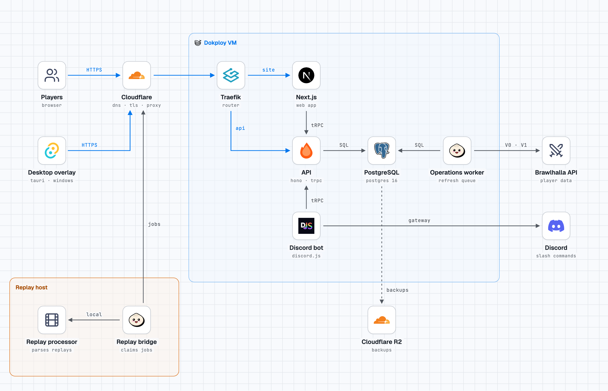

# Architecture

BrawlTome is one Postgres database, one API process, one operations worker and the apps around them. This page covers
how the backend code is split into modules and how those modules are loaded and migrated. For setup see
[`README.md`](../README.md); for working rules see [`CONTRIBUTING.md`](../CONTRIBUTING.md).

<picture>
  <source media="(prefers-color-scheme: dark)" srcset="architecture/overview-dark.png">
  
</picture>

## Modules

The domain code lives in `packages/modules/<name>`, published inside the repo as `@brawltome/<name>`. Each module owns
one Postgres schema and the migrations that create it, and exposes one `index.ts`.

| Module | Schema | Owns |
| --- | --- | --- |
| `accounts` | `accounts` | Discord sign-in, preferences, pinned players, primary player verification |
| `clan` | `clans` | Clan profiles and refreshes |
| `discovery` | `discovery` | Finding players and clans worth tracking |
| `player` | `players` | Profiles, career and ranked stats, freshness, name verification |
| `queue` | `queue` | The job queue: leases, scheduling, dead letters |
| `ranking` | `rankings` | Leaderboard snapshots and their retention |
| `replay-analysis` | `replay_analysis` | Replay analysis jobs |
| `request-admission` | `request_admission` | Rate limits for visitors and for the Brawlhalla API budget |
| `statistics` | `statistics` | Cohorts, legend meta, weapon usage, history |

Every `index.ts` exports a `<name>Module` object:

```ts
export const rankingModule = {
  name: 'ranking',
  dependsOn: ['queue'],
  migrations,
} satisfies BrawltomeModule
```

`dependsOn` lists the modules that must be loaded beside it. At run time that, plus the optional `routes` described
under API, is all a module registers: the rest of `index.ts` is plain exports, mostly `createPostgres<Thing>(database)`
factories. Adding a module to the build checks is a separate step, listed under Checks.

Modules are rebuilt one at a time. Until then a module keeps its old layout; see
[`packages/modules/README.md`](../packages/modules/README.md) for the target one.

## Shared code

`@brawltome/foundation` (`packages/foundation`) is what every module builds on:

- `createDatabase` and the `Database` and `Sql` types, a thin wrapper over postgres.js
- `jsonb()` and `json()`, the column builders for json in drizzle tables
- `parsePositiveInteger`, `parseBoundedInteger` and `requirePositiveInteger` for reading config
- the `Migration` type and the migration runner
- `BrawltomeModule`, `ModuleRuntime` and `checkModuleList`
- `publicProcedure` and `internalProcedure`, the oRPC bases for a module's procedures
- `@brawltome/foundation/testing`, which has `createTestDatabase` and `expectTablesMatchDatabase`. The latter checks
  a module's drizzle tables against its migrated schema. Only test files may import it.

Tables use `timestamptz`, never `timestamp`: postgres.js reads a `timestamp` in the process's local time zone. A
`jsonb` or `json` column in a drizzle table uses foundation's `jsonb()` or `json()`. drizzle's own builders encode the
value and the shared client encodes it again, so the database would store a JSON string.

`@brawltome/bhapi` is the Brawlhalla API client. `@brawltome/game-data`, `@brawltome/telemetry` and
`@brawltome/contracts` hold static data, metrics helpers and the generated contracts.

## How processes load modules

Each process has a list of the modules it needs:

| Process | List |
| --- | --- |
| API | `apps/api/src/modules.ts` (`apiModules`) |
| Operations worker | `apps/api/src/worker-modules.ts` (`workerModules`) |
| `bun run db:migrate` | `tooling/database-migrations/src/modules.ts` (`migrationModules`) |

The worker leaves out `replay-analysis`; the other two lists have all nine. At start-up `serve.ts` and
`operations-worker.ts` call `checkModuleList` on their list, which fails on a duplicate name, a missing dependency, a
dependency cycle, migrations under more than one owner name in a module, or one owner name shared by two modules.
They then build the module factories by
hand from one shared database client and pass the modules' migrations to the readiness check, so a process reports
unready until the schema has what it expects.

The API shares one database client between all its modules. The worker opens three clients by role: main, lease
renewals and discovery. Pool sizes and the connection budget are under Production in
[`CONTRIBUTING.md`](../CONTRIBUTING.md#production).

## Migrations

A migration is a typed object (`Migration` in `packages/foundation/migration.ts`) with an `identity` like
`rankings/0002`: the owner name, then four digits. The owner name is the schema name with hyphens instead of
underscores (`refresh-operations/0007`), so it isn't always the module's name: the `queue` module's migrations are
`refresh-operations/`. A database records these identities, so they never change. A migration also has a `predecessor`
in the same module, a `checksum` of its SQL, and optionally `requires`: identities from other modules that must run
first. The files sit in each module's `migrations/` folder.

`db:migrate` runs `tooling/database-migrations/src/cli.ts`. It collects the migrations of every module in
`migrationModules`, orders them with `orderMigrations`, takes an advisory lock and applies what is still pending.

The order is:

1. The 84 migrations production had applied before this scheme are listed in
   `packages/foundation/migrations/deployed-order.ts`. That list is frozen: never edit, reorder or extend it.
2. Every later migration comes after its `predecessor` and its `requires`. When several are ready, the one with the
   lowest identity goes first.

There is no central list of migrations any more, but each module still keeps its own. A new migration is a file in
the module's `migrations/` folder that is imported in the module's `index.ts` and added to the `migrations` array
that the `<name>Module` object passes on. The runner only reads that array, so a file that isn't in it never runs. A
new migration that names another module's schema must list one of that module's migrations in `requires`, so that
module's tables exist first.
The runner refuses a changed checksum on an applied migration, a missing predecessor, an unknown `requires` and cycles.

Migrations still have to be backward compatible with the release that serves during a deploy; see
[`CONTRIBUTING.md`](../CONTRIBUTING.md#rules-that-are-easy-to-break).

## Checks

`bun run architecture:check` (`tooling/architecture`) enforces the boundaries:

- A module's `package.json` exports only `.`, which is its `index.ts`. Other packages can't import deeper paths.
- `@brawltome/foundation/testing` is test-only.
- A module may import only the modules the policy lists for it (`capabilityDependencies` in
  `tooling/architecture/src/current-policy.ts`).
- A module may import `@brawltome/contracts` for the schemas of its procedures. Contracts may not import a module.
- A module's non-test source can't hold SQL that names another module's schema. Modules that fence a write with a
  queue lease call the fence functions `@brawltome/queue` exports, which take the caller's transaction. Deployed
  migrations are skipped; a new migration may name another module's schema only when its `requires` lists a
  migration of that module.
- A module's `index.ts` exports no drizzle tables, views or schemas. drizzle queries hold no `schema.table` text, so the
  SQL check above couldn't see another module querying them.
- Every module a module may import is in its `dependsOn`, so an import never points at a module that isn't loaded.

The last two are tests in `tooling/architecture/tests/module-surfaces.test.ts`. The policy file is where a new module
is registered for these checks, along with that test and the three module lists above.

## API

The API is Hono. tRPC (`apps/api/src/router`, `apps/api/src/trpc`) serves the site and the bot at `/trpc/*`, and a few
plain routes live in `apps/api/src/routes`. oRPC (`apps/api/src/orpc`) runs beside it while the modules move over one
at a time: `/rpc/*` speaks the oRPC protocol, `/v1/*` is the same router as plain HTTP, and `/openapi.json` is the
generated OpenAPI document, which lists only what `/v1` serves. tRPC stays until each module's routes have moved.

The API's own `status` procedure lives in `apps/api/src/orpc`. Everything else comes from the modules. A module
contributes procedures through its module object:

```ts
export const clanModule = {
  name: 'clan' as const,
  dependsOn: [],
  migrations,
  routes: createClanProcedures,
} satisfies BrawltomeModule
```

`routes(runtime)` gets a `ModuleRuntime` (for now only the shared `database`; modules don't see the process env) and
returns the module's oRPC procedures, keyed by name. Its type is an oRPC router over foundation's `RequestContext`, so
`satisfies BrawltomeModule` catches a procedure that expects more from the request than the API gives modules. The
procedures live in the module's `api/` folder and take their input and output schemas from `@brawltome/contracts`.
`serve.ts` calls `createOrpcRouter(apiModules, runtime)` once at startup, which puts each module's procedures under the
module's name: clan's `byId` is `clan.byId` at `/rpc/clan/byId`, and `GET /v1/clans/{id}` through the path in its
`.route()`. A module left out of `apiModules` is not served at all. `apiModules` is a const tuple and the name is a
literal (`'clan' as const`), so `OrpcRouter` (in `router.ts`) keeps every procedure's types for a typed client. Without
the literal the router type would accept any key.

A module builds each procedure on one of two bases from `@brawltome/foundation`: `publicProcedure` for what anyone
may call, or `internalProcedure` for what only the site and the bot may call, like tRPC's `internalProcedure`. The
API works out `isInternalCaller` once per request from the `x-internal-secret` header, compared in constant time
against `INTERNAL_API_SECRET`, so modules never see the secret. An internal procedure answers anyone else with
`FORBIDDEN` (403 over `/v1`), and `/openapi.json` marks it with the `internalSecret` header scheme. Pick the same
access the tRPC procedure has; opening a read to the public is a separate decision. `status` is public, and the clan
reads are internal.

Don't pass `spec` to `.route()` on an internal procedure. oRPC merges route options shallowly, so a procedure's own
`spec` replaces the one that adds the `internalSecret` marker. The `FORBIDDEN` check still runs, but `/openapi.json`
would show the procedure as open.

While the website still calls tRPC, a moved read is served twice. The tRPC procedure in `apps/api/src/router` becomes
a thin adapter: it calls the same exported module function as the oRPC procedure, such as `readClanProfile`, so both
answer with one implementation. The adapters go once the website has switched to oRPC.
